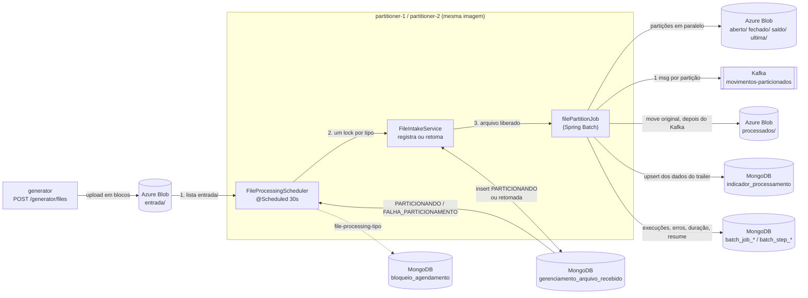
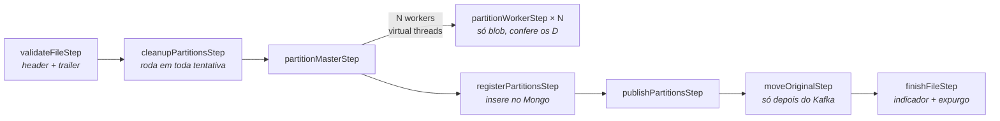

# Arquitetura

## Visão geral



As duas instâncias rodam o mesmo scheduler a cada 30 segundos. Em cada ciclo, a instância:

1. **Lista todos os arquivos de `entrada/`**, sem limite, e acrescenta os documentos do Mongo que
   ainda não terminaram (`PARTICIONANDO`, `FALHA_PARTICIONAMENTO`). Esse acréscimo cobre o arquivo
   que já foi movido para `processados/` mas não chegou a ser concluído.
2. **Agrupa por tipo de movimento** e disputa o **lock ShedLock do tipo** (`file-processing-<tipo>`).
   Tipos diferentes rodam em paralelo, inclusive em instâncias diferentes; um mesmo tipo nunca roda
   em duas instâncias ao mesmo tempo, e dentro do lock os arquivos do tipo vão um de cada vez. Não há
   ordenação por data nem dependência entre tipos.
3. **Registra ou retoma cada arquivo** e roda o job. Ver [Controle de concorrência](#controle-de-concorrência).

Um arquivo com falha **permanece em `entrada/`** e o documento dele fica na
`gerenciamento_arquivo_recebido`. Ele é retomado automaticamente enquanto houver tentativas
(`FALHA_PARTICIONAMENTO`) e, esgotadas as tentativas, fica em `FALHA` aguardando tratativa manual —
sem bloquear nenhum outro arquivo. **No sucesso, o documento do arquivão é removido** e ficam só as
partições (ver [Expurgo do arquivão](#expurgo-do-arquivão)).

**Dados de execução ficam só no JobRepository.** A `gerenciamento_arquivo_recebido` guarda o
arquivo (status, `tentativas`, blob, movimento, trailer, partições); tentativa, erro, início, fim e
duração de cada execução estão em `batch_job_execution`/`batch_step_execution`. O job é identificado
pelo parâmetro `fileName`, então cada nome de arquivo tem uma única `JobInstance`.

## Layout do arquivo

O arquivo do mainframe tem exatamente **um header na primeira linha, um trailer na última** e, entre
eles, só linhas de detalhe. Cada linha é reconhecida pelo primeiro byte (`LineType`):

| Indicador | Linha | Campos fixos | Tamanho padrão |
|---|---|---|---|
| `H` | Header | `H` + data do movimento (`yyyy-MM-dd`) + tipo (7, completado com espaços) | 18 bytes |
| `D` | Detalhe | `D` + dados do extrato | 150 bytes |
| `T` | Trailer | `T` + quantidade de registros (15 dígitos, zeros à esquerda) + data de processamento (`yyyy-MM-dd`) | 26 bytes |

```
H2026-10-08ABERTO
D.....................................................................................
D.....................................................................................
T0000000010000002026-10-09
```

A quantidade do trailer conta só as linhas `D`. A quebra de linha depois do trailer é opcional: o
arquivo é aceito com e sem ela.

### Tamanhos e quebra de linha configuráveis

Os três tamanhos (sem contar a quebra) e o separador vêm de variáveis de ambiente:

```yaml
app:
  file:
    line-separator: ${APP_FILE_LINE_SEPARATOR:LF}     # LF ou CRLF
    header-length: ${APP_FILE_HEADER_LENGTH:18}       # mínimo 18
    detail-length: ${APP_FILE_DETAIL_LENGTH:150}      # mínimo 1
    trailer-length: ${APP_FILE_TRAILER_LENGTH:26}     # mínimo 26
```

Um tamanho abaixo do mínimo impede a aplicação de subir. Header ou trailer maiores que os campos
fixos têm o restante tratado como preenchimento: ignorado na leitura, copiado como veio para as
partições (header) e completado com espaços quando a aplicação escreve o trailer da partição.

O `FileLayout` é construído a partir dessa configuração e faz toda a aritmética de offsets:

| Medida (padrão) | LF | CRLF |
|---|---|---|
| Linha de header | 19 bytes | 20 bytes |
| Linha de detalhe | 151 bytes | 152 bytes |
| Trailer | 26 bytes (+1 com quebra final) | 26 bytes (+2 com quebra final) |
| Offset da linha de detalhe N | `19 + N × 151` | `20 + N × 152` |
| Linhas de detalhe | `(tamanho − 19 − 26 [− 1]) / 151` | `(tamanho − 20 − 26 [− 2]) / 152` |

**Validação obrigatória.** Uma configuração errada não produz erro óbvio: ela desloca todos os
offsets e geraria partições corrompidas silenciosamente. Por isso o tamanho do arquivo precisa fechar
exatamente com o layout, e header e trailer são validados contra o separador configurado:

```
quebra de linha do header não corresponde ao layout configurado (LF): byte 18 é 0xd
```

### Um único header e um único trailer

Como as posições são fixas, a regra é estrutural: a linha 0 tem que ser `H`, a última tem que ser `T`
e todas as do meio têm que ser `D`. Um `H` ou `T` no meio do arquivo falha na conferência das linhas
de detalhe, e uma linha a mais ou a menos falha na conta de tamanho.

A conferência das linhas `D` é feita pelo `DetailLineScanner` durante a cópia em streaming, sobre os
bytes que já passam pela memória: em cada início de linha confere o indicador `D` e, no fim, os bytes
da quebra. O custo é ler 1 byte a cada 151, desprezível. Qualquer divergência gera
`InvalidFileException` (`FALHA`, sem retentativa):

```
linha 152: indicador 'H' (header) onde era esperado 'D' (detalhe)
```

Com `app.partition.server-side-copy=true` (Put Block From URL) os bytes vão de blob para blob dentro
da Azure e nunca passam pela aplicação. Nesse modo a conferência das linhas fica desligada e o
conteúdo é assumido como correto; a quantidade de linhas vem do tamanho, que é exata porque todas as
linhas têm tamanho fixo. O log `partition.upload` registra `lineCheck=verified` ou `lineCheck=skipped`.

### Por que não `FlatFileHeaderCallback`

O Spring Batch tem `FlatFileHeaderCallback`/`FlatFileFooterCallback` (escrever header e trailer num
`FlatFileItemWriter`) e `setSkippedLinesCallback` (receber o header lido pelo `FlatFileItemReader`).
Todos pertencem a steps chunk-oriented que leem, convertem e gravam linha a linha. O particionamento
copia faixas de bytes em blocos de 8 MB, sem converter linhas — é isso que processa 250 milhões de
linhas (35 GB) em ~148 s. Usar reader/writer exigiria converter cada linha, um `Resource` próprio para
o Azure Blob e abrir mão da escrita atômica por block list. O equivalente no nosso modelo é gravar o
header como bloco 0 e o trailer como último bloco da block list de cada partição.

## Paralelismo do particionamento

São dois níveis, ambos com virtual threads:

1. **Entre partições:** o `partitionMasterStep` distribui as N partições (`app.partition.count`) em
   virtual threads, uma por partição.
2. **Dentro de cada partição:** cada partição divide sua faixa de bytes em
   `app.partition.threads-per-partition` trechos alinhados ao bloco de upload, e cada trecho é lido
   e enviado por uma virtual thread.

O segundo nível é seguro porque o Azure Blob monta o arquivo por *block list*: cada bloco é enviado
com um identificador próprio e a ordem final do arquivo é a do `commitBlockList`, não a ordem em que
os blocos chegaram. A `PartitionCopy` (`StreamingPartitionCopy` ou `ServerSidePartitionCopy`,
conforme `app.partition.server-side-copy`) calcula os índices de bloco de forma determinística — o
bloco 0 é o header, cada trecho conhece o índice do seu primeiro bloco e o trailer, quando há, é o
último — e só então faz o commit. O arquivo resultante é idêntico ao do caminho sequencial, o que
`StreamingPartitionCopyTest` verifica com 1, 2, 4 e 8 threads.

Os trechos são alinhados ao bloco, não à linha, então uma linha pode começar num trecho e terminar no
seguinte. O `DetailLineScanner` confere cada byte pela sua posição absoluta no arquivo, e não pela
posição no buffer: cada indicador e cada byte de quebra cai em exatamente um buffer, e nenhuma linha é
contada duas vezes.

Como nenhum bloco é visível antes do commit, uma falha em qualquer trecho continua deixando o blob
inexistente, preservando a atomicidade por partição.

**Memória:** o custo é `partições × threads × app.blob.upload-block-size-mb`. Com 10 partições, 4
threads e blocos de 8 MB são 320 MB de buffers simultâneos, que precisam caber no limite do
container.

### Trailer nas partições

Cada partição é um arquivo H/D/T válido: o header original replicado, as linhas de detalhe da faixa e
um trailer próprio com a **quantidade de linhas da partição** e a **data de processamento do trailer
original**. O trailer fica atrás de uma flag, para poder ser retirado sem mexer no código:

```yaml
app:
  partition:
    write-trailer: ${APP_PARTITION_WRITE_TRAILER:true}
```

Com a flag desligada, a partição volta a ser só header + detalhes. Registro e verificação usam a mesma
flag para calcular o tamanho esperado.

## Job de particionamento



| Step | Responsabilidade | Classe |
|---|---|---|
| `validateFileStep` | Lê o header (início do blob) e o trailer (fim do blob), valida os dois e o tamanho do arquivo contra o layout, grava `movimento`, `trailer` e `particionamento` no documento e o resumo no ExecutionContext do job. Quantidade do trailer diferente das linhas de detalhe gera só `WARN` (`file.trailer.mismatch`): o processamento segue | `ValidateFileTasklet` |
| `cleanupPartitionsStep` | Se nenhuma tentativa anterior concluiu o `partitionMasterStep`, apaga as partições que sobraram (blob por prefixo + documentos) | `CleanupPartitionsTasklet` |
| `partitionMasterStep` | Divide as linhas em N faixas (`app.partition.count`), executa um worker por faixa em virtual threads e soma as linhas lidas no ExecutionContext do job | `FilePartitioner`, `PartitionPlan`, `PartitionLinesListener` |
| `partitionWorkerStep` | Grava o header, copia **só a faixa de bytes** da partição conferindo as linhas `D` e grava o trailer da partição. **Não grava nada no Mongo** | `PartitionWriterTasklet`, `PartitionCopy` |
| `registerPartitionsStep` | Só roda depois que **todas** as partições estão no blob. Confere as linhas lidas e se cada partição existe com o tamanho esperado, e insere todos os documentos de uma vez (status `ENVIADO`) numa transação curta | `RegisterPartitionsTasklet` |
| `publishPartitionsStep` | Publica 1 mensagem por partição ainda não publicada, aguarda o ack do broker e só então marca `publicado_em` + `CONCLUIDO` | `PublishPartitionsTasklet`, `PartitionedFilePublisher` |
| `moveOriginalStep` | Move o original para `processados/` (cópia server-side + delete, idempotente). Enquanto houver falha até aqui, o original continua em `entrada/` | `MoveOriginalTasklet`, `BlobStorage.move` |
| `finishFileStep` | Faz o upsert do indicador de processamento com os dados do trailer e **remove o documento do arquivão**. Reexecutado depois do delete, só registra que não há nada a fazer | `FinishFileTasklet` |

### Resumo do arquivo no ExecutionContext do job

| Chave | Conteúdo | Gravada por |
|---|---|---|
| `file.sizeBytes`, `file.partitions` | Tamanho do arquivão e número de partições | `validateFileStep` |
| `file.detailLines` | Linhas de detalhe calculadas pelo tamanho | `validateFileStep` |
| `file.trailerRecordCount`, `file.trailerProcessingDate` | Quantidade e data do trailer | `validateFileStep` |
| `file.detailLinesRead` | Linhas de detalhe lidas pelos workers, **sem header e trailer** | `PartitionLinesListener` |
| `file.linesVerified` | `true` se as linhas foram conferidas (streaming) | `PartitionLinesListener` |

Cada worker grava `partition.linesRead` e `partition.linesVerified` no próprio ExecutionContext. O
`JobMetricsListener` lê esse resumo para o `JOB_METRICS`, já que o documento do arquivão é apagado no
sucesso.

### Por que o particionamento é paralelo sem ler o arquivo inteiro

```
header  = H | yyyy-MM-dd | TIPO (7, padding)          | \n  = 19 bytes
detalhe = D | dados (149)                             | \n  = 151 bytes
trailer = T | quantidade (15) | yyyy-MM-dd                   = 26 bytes (+ \n opcional)

linhas     = (tamanho do blob - 19 - 26 [- 1]) / 151
partição i = bytes [19 + primeiraLinha × 151, 19 + (primeiraLinha + linhas) × 151)
trailer    = bytes [19 + linhas × 151, 19 + linhas × 151 + 26)
```

Como as linhas têm tamanho fixo, cada worker calcula a própria faixa de bytes e lê só
essa faixa do blob (HTTP range). As N partições são lidas e gravadas ao mesmo tempo. O
resto da divisão das linhas vai para as primeiras partições, uma linha a mais em cada. O trailer é
lido com uma leitura de 26 bytes na posição calculada, sem percorrer o arquivo.

### Upload em blocos e atomicidade de cada partição

`BlockOutputStream` envia blocos de tamanho fixo (`stageBlock`) e só publica o blob no
`commit()` (`commitBlockList`). Consequências:

* **Memória limitada:** no máximo um buffer de upload e um de leitura por partição. Com 8 MB, são cerca de 16 MB por partição.
* **Sem arquivo parcial:** se um worker falha no meio, nada é visível no blob, porque os blocos não confirmados são descartados pela Azure.

O `BlobOutputStream` do SDK foi descartado porque enfileira blocos sem limite quando a
leitura é mais rápida que o upload. Com arquivos de 755 MB, ele causou `OutOfMemoryError`.

## Timeouts nas chamadas ao blob

Sem timeout, uma chamada travada ao storage prende o job indefinidamente: foi o que aconteceu num
teste de carga, em que um `OutOfMemoryError` dentro do SDK deixou o particionamento pendurado, com
CPU em 0,16% e sem progresso, em vez de falhar. O cliente do blob é construído com limites em dois
níveis:

| Fase da chamada | Parâmetro | Natureza |
|---|---|---|
| Estabelecer a conexão TCP | `connectTimeout` | Duração total da fase |
| Enviar o corpo da requisição | `writeTimeout` | **Ociosidade entre blocos** |
| Esperar os headers da resposta | `responseTimeout` | Duração total da fase |
| Ler o corpo da resposta | `readTimeout` | **Ociosidade entre blocos** |
| A tentativa inteira | `tryTimeout` (`RequestRetryOptions`) | **Duração total da tentativa** |

A distinção importa: `writeTimeout` e `readTimeout` medem **ociosidade entre blocos**, não duração
total. Uma transferência lenta que continua progredindo nunca é interrompida por eles — o que é
desejável, porque não mata o download legítimo de um arquivo grande, mas significa que sozinhos eles
não limitam o tempo total. Quem limita o total é o `tryTimeout`.

```yaml
app:
  blob:
    max-tries: 3
    try-timeout-seconds: 60        # teto de cada tentativa
    retry-delay-seconds: 2
    max-retry-delay-seconds: 30
    response-timeout-seconds: 60   # headers da resposta
    connect-timeout-seconds: 10    # estabelecer a conexão
```

### O escopo do `tryTimeout`

O `tryTimeout` vale para **uma requisição HTTP**, dimensionada pelo block size — não para o arquivo,
nem para o particionamento, nem para o job. No `RequestRetryPolicy` do SDK ele é aplicado como
`responseMono.timeout(tryTimeout)`, dentro da política de retry de cada chamada.

No 250MM com blocos de 8 MB, isso significa cerca de **9.400 requisições** (≈472 downloads e
≈472 uploads por partição, vezes 10 partições), cada uma com seu próprio teto de 60 s. É por isso
que o particionamento inteiro leva minutos sem nenhum timeout disparar.

Há uma assimetria entre as duas direções, porque o `responseMono` resolve quando a **resposta
chega**, não quando o corpo termina de ser lido:

* **Upload (`stageBlock`)**: o teto cobre a operação inteira, porque a resposta só vem depois de o
  servidor receber e processar o bloco.
* **Download**: o teto cobre até os **headers**. A transferência do corpo acontece depois e fica por
  conta do `readTimeout`, que é de ociosidade — mata a conexão que fica 60 s sem receber nada, mas
  não uma que esteja lenta e constante.

A proteção no download, portanto, vem da combinação dos dois: `tryTimeout` para a requisição não
ficar parada, `readTimeout` para o fluxo não congelar no meio. Nenhum deles sozinho cobriria o caso.

Com 3 tentativas, o pior caso de uma requisição antes de o erro subir para a aplicação é da ordem de
`maxTries × tryTimeout` = 3 minutos — e não 60 s, como a leitura apressada do parâmetro sugeriria.

**Dimensionamento:** os valores precisam acomodar o pior caso legítimo. No emulador um bloco de 8 MB
sobe em dezenas de milissegundos, mas contra o Azure real, com rede intermediando, o percentil alto
é bem maior. Os 60 s são folgados de propósito — o objetivo é **impedir o travamento infinito**, não
otimizar latência. Ajustar com dados de produção.

Os atrasos injetados pelos testes de caos acontecem no código da aplicação, não nas chamadas do SDK,
então não são interceptados por esses timeouts — o cenário `slow-io`, com 90 s de atraso, continua
concluindo na primeira tentativa.

## Transações do MongoDB

O limite de transação do MongoDB em produção é **60 s** (`transactionLifetimeLimitSeconds`), e o
docker-compose usa o mesmo valor. A regra do job é **nenhum I/O externo (blob ou Kafka) dentro de
transação do Mongo**:

* **Steps sem transação do Mongo:** todos os tasklets usam `ResourcelessTransactionManager`. O `MongoTemplate` usa `SessionSynchronization.ON_ACTUAL_TRANSACTION` e, sem transação nativa do Mongo, não abre sessão. Assim uma cópia de 1,5 GB ou um move de 15 GB não fica dentro de transação. As atualizações do `StepExecution` e do `ExecutionContext` são feitas pelo JobRepository em transações curtas próprias.
* **Onde há transação:** só em `registerPartitionsStep` (`PartitionFileRepository.replaceAll`: remove + insere todas as partições). Dura milissegundos e roda depois de todo o upload.
* **Demais gravações:** são operações únicas e atômicas por natureza (`updateOne` / `updateMany`), idempotentes em caso de restart.
* **Sequências de id do JobRepository (`batch_sequences`) ficam fora da transação.** O `CustomSequenceIncrementer` usa um `MongoTemplate` próprio com `SessionSynchronization.NEVER`. Dentro da transação, todo job disputava o mesmo documento de sequência, e dois jobs simultâneos terminavam em `NoSuchTransaction` (`TransientTransactionError`) no `partitionMasterStep`, que cria as 10 step executions de uma vez. Fora da transação, o `$inc` continua atômico; o único efeito é uma lacuna na numeração quando a transação é desfeita, como numa sequence de banco.

O cenário `slow-io` do chaos test força 90 s de I/O no worker, no move e na publicação, e confere
que o arquivo termina na 1ª tentativa, sem `NoSuchTransaction`.

## Status

O código usa constantes em inglês (`FileStatus`, `FileRole`). O valor gravado no Mongo, mostrado na API
e escrito nos logs é o valor em português, convertido pelo `MongoEnumConversions` (Spring Data) e por
`@JsonValue`/`toString`.

| Constante | Valor |
|---|---|
| `PARTITIONING` | `PARTICIONANDO` |
| `FAILED_PARTITIONING` | `FALHA_PARTICIONAMENTO` |
| `FAILED` | `FALHA` |
| `UPLOADED` | `ENVIADO` |
| `COMPLETED` | `CONCLUIDO` |
| `ORIGINAL` / `PARTITION` (campo `tipo`) | `ORIGINAL` / `PARTICAO` |

| Documento | Fluxo |
|---|---|
| Original | `PARTICIONANDO` → **removido** no sucesso; em falha, `FALHA_PARTICIONAMENTO` → `PARTICIONANDO` (retomada) → removido; tentativas esgotadas ou arquivo inválido → `FALHA` (fica na collection) |
| Partição | `ENVIADO` (inserida depois de todo o upload) → `CONCLUIDO` (depois do ack do Kafka, junto com `publicado_em`) |

| Status do original | Significado | O dono do lock do tipo faz |
|---|---|---|
| `PARTICIONANDO` | Em processamento, ou interrompido (pod caiu) | Retoma: com o lock do tipo em mãos, ninguém mais está no arquivo |
| `FALHA_PARTICIONAMENTO` | Falhou e ainda tem tentativas | Retoma do passo que falhou |
| `FALHA` | Tentativas esgotadas ou arquivo inválido | Pula até `POST /files/{id}/requeue` |

A ordem **ack do Kafka → `publicado_em`/`CONCLUIDO`** é proposital. Se o processo morrer entre as
duas, a mensagem é reenviada no restart (duplicata, que o consumidor resolve pelo `blob_path`).
Na ordem inversa, a partição apareceria como publicada sem a mensagem ter sido entregue, e a
mensagem se perderia sem que desse para detectar.

## Expurgo do arquivão

Depois de mover o original para `processados/`, o `finishFileStep`:

1. faz o upsert no [indicador de processamento](#indicador_processamento) com os dados do trailer;
2. remove o documento do arquivão da `gerenciamento_arquivo_recebido`, mantendo só as partições.

As partições herdam do original os blocos `movimento` e `trailer`, então a rastreabilidade continua
nelas. Se o step falhar entre o upsert e o delete, a retomada refaz o upsert (é idempotente) e apaga o
documento; se falhar depois do delete, a retomada encontra o documento ausente e só registra
`file.finish` com `action=skip`.

O que muda com o expurgo:

| Antes | Agora |
|---|---|
| O documento `CONCLUIDO` impedia processar de novo um nome repetido | O `FileIntakeService` consulta o JobRepository: se a última execução daquele `fileName` está `COMPLETED`, registra `file.duplicate` e ignora sem criar documento. **A garantia dura o TTL do JobRepository** (`BATCH_RETENTION_DAYS`, padrão 7 dias); depois disso o mesmo nome seria processado de novo |
| `GET /files/{id}` lia o documento do original | Sem o documento, a resposta é montada pelas partições (`id_arquivo_pai`) e pela última execução: `status=CONCLUIDO`, `attempts` = número de execuções e `originalRemoved=true`. O `/verification` recalcula o caminho em `processados/` pelo `BlobPaths` |
| O `JOB_METRICS` lia linhas, bytes e tentativa do documento | Lê do ExecutionContext do job e conta as execuções no JobRepository |

## Resume e recovery

A identidade do job é o parâmetro `fileName`, então cada nome de arquivo tem uma única
`JobInstance` e cada tentativa é uma nova `JobExecution` dela. A ordem dos steps é
validar → limpar → particionar → registrar → **publicar no Kafka → mover para `processados/`** →
indicador e expurgo: o original só sai de `entrada/` depois que todas as mensagens foram confirmadas.

| Onde falhou | O que acontece na próxima tentativa |
|---|---|
| `validateFileStep`, com `InvalidFileException` (header, trailer ou tamanho) | Não há retentativa: `FALHA` direto, arquivo mantido em `entrada/` |
| `validateFileStep`, com erro transitório | Valida de novo |
| `partitionMasterStep`, com linha que não é `D` | `InvalidFileException`: `FALHA` direto, sem retentativa |
| `partitionMasterStep` (qualquer outra falha de worker) | O cleanup apaga as partições da tentativa anterior e **todos** os workers rodam de novo: o particionamento é tudo ou nada. Quem decide isso é o `SimpleStepExecutionSplitter` com `allowStartIfComplete=true`, configurado no master. Esse flag no worker é ignorado pelo splitter padrão, que retomaria só as partições que falharam |
| `registerPartitionsStep` | Particionamento pulado (`COMPLETED`), o cleanup não apaga nada e o registro é refeito. É idempotente: remove e insere de novo. As linhas lidas vêm do ExecutionContext do job, restaurado da execução anterior |
| `publishPartitionsStep` | Todos os passos anteriores são pulados e só as partições sem `publicado_em` são publicadas |
| `moveOriginalStep` | Tudo antes é pulado e o move é refeito. Se a cópia já existia e só faltava o delete, o move apenas conclui |
| `finishFileStep` | Upsert refeito; delete refeito, ou ignorado se o documento já não existe |
| Instância morreu no meio | O keep-alive para e o lock do tipo expira em até `lock-at-most-for`. A instância que adquire o lock encontra o arquivo em `PARTICIONANDO` e o retoma: o `FileExecutionRecovery` marca a execução presa em `STARTED` como `FAILED` e o restart segue as regras acima |
| `max-attempts` esgotado | `FALHA`. O arquivo e as partições já criadas ficam como estão, para a tratativa manual |

Cada retomada conta uma tentativa (`tentativas`, na raiz do documento), inclusive a de uma instância
que caiu. Um arquivo que derruba o pod sempre (falta de memória, por exemplo) vira `FALHA` depois de
`max-attempts`, em vez de ficar em loop.

A tratativa manual tem dois caminhos: `POST /files/{id}/requeue` (de `FALHA` para
`FALHA_PARTICIONAMENTO`, com as tentativas zeradas), quando a causa foi resolvida fora do arquivo; ou o
reprocessamento pelo mainframe, que gera um arquivo com **outro nome** e, portanto, um registro novo.

A publicação é *at-least-once*: se o processo morrer entre o ack do Kafka e o commit no
Mongo, a mensagem é reenviada. O `blob_path` é único por partição e serve de chave de
idempotência para o consumidor.

## Controle de concorrência

```yaml
app:
  partition:
    concurrency-control: ${APP_PARTITION_CONCURRENCY_CONTROL:TYPE_LOCK}   # TYPE_LOCK | GLOBAL_LOCK
    max-concurrent-types: ${APP_PARTITION_MAX_CONCURRENT_TYPES:1}
```

| Modo | Lock | Comportamento |
|---|---|---|
| `TYPE_LOCK` (padrão) | ShedLock por tipo (`file-processing-<tipo>`) | Um arquivo por tipo de movimento por vez no cluster; tipos diferentes em paralelo, inclusive entre instâncias |
| `GLOBAL_LOCK` | ShedLock único (`file-processing`) | Um arquivo por vez no cluster inteiro |

| Lock | Modo | Protege |
|---|---|---|
| `file-processing-aberto`, `-fechado`, `-saldo`, `-ultima` | `TYPE_LOCK` | Os arquivos daquele tipo |
| `file-processing-desconhecido` | `TYPE_LOCK` | Arquivos cujo nome não segue o padrão `MOV_<TIPO>_yyyy.MM.dd...` |
| `file-processing` | `GLOBAL_LOCK` | Todos os arquivos |

`max-concurrent-types` limita quantos tipos **uma** instância processa ao mesmo tempo; o paralelismo
entre instâncias não depende dele. Não existe lock de poll: listar o blob é só leitura, e o registro
de cada arquivo acontece dentro do lock do seu tipo.

Os locks são adquiridos pela API programática do ShedLock (`LockingTaskExecutor`), com validade
`lock-at-most-for`, renovada pelo keep-alive enquanto o processamento durar. No `GLOBAL_LOCK`, o
`lock-at-least-for` (padrão 20 s) vira um pedágio a cada ciclo; quem usar esse modo deve reduzi-lo.

### Registro e retomada do arquivo

Dentro do lock do tipo, o `FileIntakeService` decide o que fazer com cada arquivo listado:

| Situação | Operação | Resultado |
|---|---|---|
| Sem documento, nome já concluído no JobRepository | — | `file.duplicate` em WARN: o mesmo nome já foi processado; ignorado até tratativa manual |
| Sem documento | `insert` com status `PARTICIONANDO` e `tentativas = 1` | `_id` = UUID do nome do arquivo. Um `DuplicateKeyException` é registrado como `file.concurrent` e o ciclo segue para o próximo |
| `PARTICIONANDO` ou `FALHA_PARTICIONAMENTO`, com tentativas | `findAndModify` com `tentativas < max-attempts` | Fica `PARTICIONANDO`, `tentativas + 1`, e o job é retomado (`file.resume`) |
| `PARTICIONANDO` ou `FALHA_PARTICIONAMENTO`, sem tentativas | `updateOne` com `tentativas >= max-attempts` | Vira `FALHA` |
| `FALHA` | — | `file.skip` em DEBUG até `POST /files/{id}/requeue` |

Não há prazo de "arquivo parado": como só o dono do lock do tipo chega a este ponto, um arquivo em
`PARTICIONANDO` fora de um job é sempre um processamento interrompido, e é retomado no primeiro
ciclo depois que o lock fica livre. Nenhum arquivo fica parado sem execução.

### Proteção contra a instância que volta de um congelamento

O ShedLock não tem *fencing*. Se a instância A congelar (pausa longa de GC, CPU estrangulada, rede
cortada até o Mongo), o keep-alive congela junto, o lock expira e B assume o tipo e retoma o arquivo.
Quando A volta, o job dela continua de onde estava.

A proteção usa o próprio JobRepository, sem nenhum campo na collection de arquivos e sem mexer no
ShedLock. Ao retomar, B cria uma nova `JobExecution` da mesma `JobInstance` (e o
`FileExecutionRecovery` marca a de A como `FAILED`). A partir daí, a execução de A deixa de ser
a **última** execução do arquivo, e o `FileJobExecutions.isCurrent(fileName, jobExecutionId)` passa a
responder `false` para ela:

| Momento | Regra |
|---|---|
| Início de cada step (inclusive cada worker de partição) | `FileStepSupport` confere se a execução ainda é a corrente; se não for, lança `FileOwnershipLostException` e o job de A falha |
| `afterJob` | `FileStatusJobListener` só grava `FALHA_PARTICIONAMENTO` ou `FALHA` se a execução ainda for a corrente; senão registra `file.ownership.lost` e não altera nada. No sucesso não há o que gravar: o `finishFileStep` já removeu o documento |

O que A ainda pode fazer é terminar o que estava **dentro** de um step quando congelou: gravar uma
partição com o mesmo conteúdo que B grava, ou reenviar mensagens que o consumidor já deduplica pelo
`blob_path`. Nenhum desses efeitos altera o resultado. O cenário `zombie-owner` do chaos test
congela a instância com `docker pause` e confere exatamente isso.

Se A abortar sem gravar status (ou qualquer outra falha deixar o arquivo em `PARTICIONANDO` sem job
rodando), o próximo dono do lock do tipo o retoma — a proteção nunca deixa arquivo parado.

### Concorrência na criação de jobs

1. **Criação duplicada de `JobInstance`.** O **índice único em `(job_name, job_key)`** (criado no
   `mongo-init`) transforma uma eventual corrida em erro de chave duplicada. Com o lock ela não deve
   acontecer, mas o tratamento continua: `file.concurrent` no log, nenhuma mudança de status e o ciclo
   segue para o próximo.
2. **`JobInstance` sem execução.** Se o lançamento falha entre criar a instância e gravar a execução,
   sobra uma instância órfã. O `FileExecutionRecovery.removeOrphanInstance` descarta, antes de lançar, apenas
   instâncias **sem nenhuma execução**, preservando o caminho de resume.

O lançamento do job **não é envolvido em retry**: criar uma `JobInstance` não é idempotente. Uma
falha de lançamento segue a regra normal de retentativa (`FALHA_PARTICIONAMENTO`).

### Provider customizado

O `MongoLockProvider` oficial deixa trocar só o nome da collection. Os campos são fixos:
`_id`, `lockUntil`, `lockedAt` e `lockedBy`. `ConfigurableMongoLockProvider` implementa
`ExtensibleLockProvider` com o **mesmo algoritmo** do provider oficial e faz as operações via
`MongoTemplate`, usando os nomes definidos em `app.shedlock.*`:

| Operação | Filtro | Update |
|---|---|---|
| `lock` (upsert) | `name == X AND bloqueado_ate <= now` | `bloqueado_ate`, `bloqueado_em`, `bloqueado_por`. Duplicate key significa que o lock está ocupado |
| `extend` | `name == X AND bloqueado_ate > now AND bloqueado_por == eu` | `bloqueado_ate` |
| `unlock` | `name == X` | `bloqueado_ate = max(now, lockAtLeastUntil)` |

* **Duplicate key:** se o campo do nome não for `_id`, o store cria um índice único nele. Sem esse índice, o upsert não gera duplicate key e duas instâncias conseguiriam o lock.
* **Write concern:** o `MongoTemplate` do lock usa `WriteConcern.MAJORITY`.
* **Keep-alive:** o `KeepAliveLockProvider` renova o lock a cada `lock-at-most-for / 2` enquanto o processamento roda. Um arquivo grande não perde o lock, e um lock órfão expira em até `lock-at-most-for`.

```yaml
app:
  shedlock:
    collection: ${APP_SHEDLOCK_COLLECTION:bloqueio_agendamento}
    locked-by: ${POD_NAME:${HOSTNAME:local-instance}}
    fields:
      name: ${APP_SHEDLOCK_FIELD_NAME:_id}
      lock-until: ${APP_SHEDLOCK_FIELD_LOCK_UNTIL:bloqueado_ate}
      locked-at: ${APP_SHEDLOCK_FIELD_LOCKED_AT:bloqueado_em}
      locked-by: ${APP_SHEDLOCK_FIELD_LOCKED_BY:bloqueado_por}
```

### Dono do lock no Kubernetes (Downward API)

O `bloqueado_por` identifica a instância dona do lock e precisa ser **único por réplica**: é por ele
que só o dono consegue estender o lock. O valor vem de `POD_NAME`, com `HOSTNAME` e `local-instance`
como alternativas.

* **Nome do pod, não do container:** o nome do container vem do `spec` do deployment e é igual em todas as réplicas; duas réplicas gravariam o mesmo dono e uma conseguiria estender ou liberar o lock da outra.
* **Por que não só `HOSTNAME`:** dentro do pod o `HOSTNAME` normalmente é o nome do pod, mas deixa de ser com `hostNetwork: true` (vira o nome do node, repetido entre pods do mesmo node) ou com `spec.hostname` definido.

No deployment, a Downward API injeta o nome do pod:

```yaml
env:
  - name: POD_NAME
    valueFrom:
      fieldRef:
        fieldPath: metadata.name
```

Localmente o docker-compose define `hostname: partitioner-1` e `partitioner-2`, que chegam pelo
`HOSTNAME`.


## Infraestrutura criada fora da aplicação

A aplicação **não cria nada** no startup: nem collection, nem índice, nem tópico, nem container do
blob. Se algo não existir, a operação falha e o problema aparece no log, em vez de a aplicação
criar um recurso com a configuração errada em produção.

| Recurso | Quem cria | Script |
|---|---|---|
| Replica set, collections (`batch_*`, `gerenciamento_arquivo_recebido`, `indicador_processamento`, `bloqueio_agendamento`), sequences e índices | `mongo-init` | [`docker/mongo-init.sh`](../docker/mongo-init.sh) + [`docker/mongo-collections.js`](../docker/mongo-collections.js) |
| Índices TTL de expurgo do JobRepository | `mongo-init` | [`docker/mongo-ttl-indexes.js`](../docker/mongo-ttl-indexes.js) |
| Tópico `movimentos-particionados` (10 partições) | `kafka-init` | [`docker/kafka-init.sh`](../docker/kafka-init.sh) |
| Container `movimentos` no blob | `azurite-init` | [`docker/azurite-init.sh`](../docker/azurite-init.sh) |

Os três rodam como containers de init no compose, e o generator e os particionadores só sobem
depois que eles terminam (`service_completed_successfully`). Os scripts são idempotentes, então
`make infra-init` pode ser reexecutado. O índice único do lock só é criado quando
`app.shedlock.fields.name` não é `_id`, que é a mesma condição que o provider exige.

## Collections

As collections da aplicação e os campos delas são em português; o código continua em inglês, com o
mapeamento centralizado em `ReceivedFileFields`, `ProcessingIndicatorFields` e nos `@Field`.

| Collection | Conteúdo |
|---|---|
| `batch_job_instance`, `batch_job_execution`, `batch_step_execution`, `batch_sequences` | JobRepository customizado, mesma estrutura do `poc-spring-batch` (snake_case e TTL de expurgo) |
| `gerenciamento_arquivo_recebido` | Arquivão (`tipo=ORIGINAL`) enquanto não termina e suas partições (`tipo=PARTICAO`, `id_arquivo_pai` = id do original) |
| `indicador_processamento` | Data e quantidade do trailer por data de movimento e tipo |
| `bloqueio_agendamento` | Locks do ShedLock (nome e campos configuráveis) |

### `gerenciamento_arquivo_recebido`

```json
{
  "_id": "efee6081-b5fa-302b-b84e-c6fc7a3e4e30-p0001",
  "tipo": "PARTICAO",
  "id_arquivo_pai": "efee6081-b5fa-302b-b84e-c6fc7a3e4e30",
  "nome_arquivo": "MOV_ABERTO_2026.10.08.22.38.29.109656_part_0001.txt",
  "status": "CONCLUIDO",
  "tentativas": 1,
  "blob": {
    "caminho_origem": "entrada/MOV_ABERTO_2026.10.08.22.38.29.109656.txt",
    "caminho_atual": "aberto/2026-10-08/efee6081-.../MOV_ABERTO_2026.10.08.22.38.29.109656_part_0001.txt",
    "etag": null,
    "tamanho_bytes": 15100046
  },
  "movimento": { "header": "H2026-10-08ABERTO ", "tipo": "ABERTO", "data": "2026-10-08" },
  "trailer": { "quantidade_registros": 1000000, "data_processamento": "2026-10-09" },
  "particionamento": { "indice": 1, "quantidade": 10, "quantidade_linhas": 100000, "byte_inicio": 19, "byte_fim": 15100019 },
  "auditoria": { "criado_em": "...", "atualizado_em": "...", "publicado_em": "..." }
}
```

O original tem `tipo=ORIGINAL`, `id_arquivo_pai` nulo, `etag` do blob recebido e `particionamento`
com o total de linhas e de partições. Ele só existe enquanto o arquivo não termina com sucesso; no
sucesso é removido pelo `finishFileStep`. Todo documento nasce com `tentativas = 1`.

**Não há dados de execução nesta collection.** Tentativas anteriores, erro, início, fim e duração
vêm do JobRepository: a última execução do arquivo é `jobRepository.getLastJobExecution(
"filePartitionJob", {fileName})`, exposta em `GET /files/{id}` no campo `lastExecution`, e as
execuções ficam consultáveis direto em `batch_job_execution` pelo parâmetro `fileName`.

* **Id do original:** `UUID.nameUUIDFromBytes(nome do arquivo)`. É a chave única do arquivo: o mesmo nome nunca é processado duas vezes enquanto o JobRepository guardar a execução concluída, mesmo que o conteúdo mude. O reprocessamento vem do mainframe com **outro nome** e, por isso, vira um registro novo.
* **Não há índice em `nome_arquivo`:** a unicidade vem do índice implícito do `_id`, que já é derivado do nome.
* **Id da partição:** `<id do original>-p0001`.

### `indicador_processamento`

Um documento por **data do header** (`_id`, `yyyy-MM-dd`). Para cada tipo de movimento processado, o
`finishFileStep` grava a data de processamento e a quantidade **do trailer** do arquivão:

```json
{
  "_id": "2026-10-08",
  "data_processamento_movimento_aberto": "2026-10-09",
  "quantidade_movimento_aberto": 1000000,
  "data_processamento_movimento_fechado": "2026-10-09",
  "quantidade_movimento_fechado": 250000
}
```

* **Upsert por tipo:** `updateOne({_id}, {$set: {os 2 campos do tipo}}, {upsert: true})`. Só os campos do tipo processado mudam; tipos que ainda não chegaram não aparecem no documento.
* **Reprocessamento:** a mesma data e o mesmo tipo sobrescrevem os dois campos (vale o último).
* **Concorrência:** tipos diferentes da mesma data processados ao mesmo tempo fazem upsert no mesmo `_id`. O MongoDB repete sozinho o upsert por `_id` que esbarra em chave duplicada, e como cada tipo grava campos diferentes, não há perda. `ProcessingIndicatorRepositoryIntegrationTest` cobre esse caso.
* **Consulta:** `GET /indicators/{data}`.

## Pastas no blob

```
entrada/<arquivo>.txt                                   recebido, em processamento ou com falha
processados/<data>/<fileId>/<arquivo>.txt               original já particionado
aberto|fechado|saldo|ultima/<data>/<fileId>/<arquivo>_part_0001.txt
```

O `fileId` no caminho das partições permite apagar todas as partições de um arquivo só
pelo prefixo, inclusive as que foram enviadas mas não chegaram a ser registradas no Mongo.

## Mensagem Kafka

Tópico `movimentos-particionados`, com 10 partições. A key é o nome do arquivo
particionado, o que distribui as mensagens entre as partições e permite consumo paralelo.

```json
{ "movement_type": "ABERTO", "blob_path": "aberto/2026-09-16/<fileId>/MOV_..._part_0001.txt", "movement_date": "2026-09-16" }
```

## Estrutura do código

```
br.com.spring.batch.partitioner
├── controller    REST: gerador, consulta/verificação de arquivos, indicador, locks, chaos (profile chaos)
├── service       ciclo (polling → lock → job), intake (listagem, registro, retomada e deduplicação), runner do job,
│                 status, consulta (FileQueryService) e verificação
│   └── generation  worker de geração de massa (profile generator)
├── scheduler     FileProcessingScheduler (@Scheduled, request_id e log do ciclo)
├── batch         definição do job (FilePartitionJob, FilePartitionJobConfig), consultas ao JobRepository
│   │             (FileJobExecutions), recuperação de execução abandonada (FileExecutionRecovery) e FileStepSupport
│   ├── tasklet     um tasklet por step, com a regra do step dentro dele
│   ├── partition   Partitioner do Spring Batch e as estratégias de cópia (streaming e server-side)
│   ├── progress    log de progresso por partição e por arquivo
│   ├── listener    status do arquivo, soma das linhas lidas e métricas (STEP_METRICS / JOB_METRICS)
│   └── metrics     StepVolume e Throughput
├── repository    gerenciamento_arquivo_recebido e indicador_processamento como MongoRepository (updates
│                 parciais nas implementações *CustomImpl), converters dos enums e o JobRepository customizado (batch/)
├── model         documentos Mongo, layout H/D/T (LineType, FileHeader, FileTrailer, FileLayout, DetailLineScanner),
│                 plano de partições e evento Kafka
├── storage       BlobStorage (acesso ao Azure Blob), BlockList e BlockOutputStream
├── lock          LockProvider configurável do ShedLock e ProcessingLock
├── messaging     publicação no Kafka
├── config        beans e propriedades
└── support       log estruturado, request_id, chaos (só no profile chaos, aplicado por proxy nas tasklets)
```

Ver também: [TESTING.md](TESTING.md) · [OBSERVABILITY.md](OBSERVABILITY.md) · [README](../README.md).
